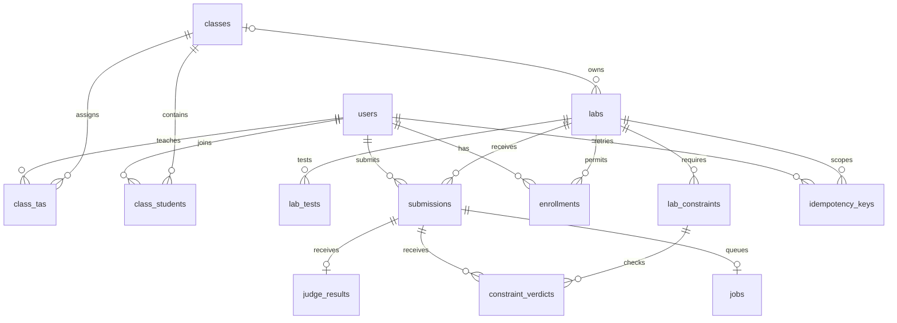

# Current database structure

- **Database:** PostgreSQL 17, accessed from Go through `pgx`.
- **Schema source:** `backend/migrations/00001` through `00004`.
- **Local port:** `5433`. Migrations preserve the existing local data.
- **Storage:** Named Docker volume `postgres_data` in Compose; survives normal container restarts. `docker compose down -v` deletes it.
- **Backend guide:** See [BACKEND.md](BACKEND.md) for commands, files, and routes.

## Relationships



- **Primary key (PK):** Identifies a row, like an object's unique `id` in JavaScript.
- **Foreign key (FK):** Requires a linked row to exist in another table.
- **Unique key:** Prevents duplicate values or duplicate combinations.
- `sessions` keeps its user ID inside session data, so it has no direct user FK.

## Tables and important fields

| Table | Fields | Purpose and rules |
|---|---|---|
| `users` | `id`, `email`, `password_hash`, `role` | UUID PK; unique email; role is `admin`, `ta`, or `student`. No plain-text passwords. |
| `sessions` | `token`, `data`, `expiry` | Token PK; stores server-side SCS login sessions. Index on expiry supports cleanup. |
| `classes` | `id`, `name` | UUID PK; groups TAs, students, and labs. |
| `class_tas` | `class_id`, `ta_id` | Combined PK; links classes to users. The API requires the assigned user to be a TA. |
| `class_students` | `class_id`, `student_id` | Combined PK; links classes to users. The API requires the assigned user to be a student. |
| `labs` | `id`, `title`, `class_id`, `statement` | UUID PK; class FK; statement stored as plain text containing Markdown, rendered by the frontend. New labs require a TA's class. Old PA2 labs may have a null class and an empty statement. |
| `lab_tests` | `id`, `lab_id`, `input`, `expected_output` | UUID PK; test inputs and expected outputs. Removed with their lab through `ON DELETE CASCADE`. |
| `lab_constraints` | `id`, `lab_id`, `description`, `deduction` | UUID PK; TA-written constraint and nonnegative numeric deduction. Removed with their lab through `ON DELETE CASCADE`. |
| `enrollments` | `lab_id`, `student_id` | Combined PK; controls whether a student may submit to a lab. Class students are enrolled when the TA creates a lab. |
| `submissions` | `id`, `lab_id`, `student_id`, `source`, `created_at` | UUID PK; source is `bytea` so submitted bytes, including NUL, are preserved. |
| `jobs` | `id`, `submission_id`, `status`, `created_at`, `lease_token`, `leased_until`, `attempts` | UUID PK; submission FK is unique. Tracks durable judging work and recovery after a worker crash. Index on status and creation time supports job claims. |
| `judge_results` | `submission_id`, `verdict`, `detail`, `judged_at` | Submission FK is also the PK: at most one result per submission. Stores Accepted, Wrong Answer, resource errors, or Judge Error. |
| `constraint_verdicts` | `submission_id`, `constraint_id`, `verdict`, `evidence`, `source` | Combined PK: at most one verdict per submission/constraint. Verdict is `pass`, `violation`, or `unsure`. Evidence is JSONB. No deduction or published mark is stored here. |
| `idempotency_keys` | `student_id`, `lab_id`, `key`, `fingerprint`, `response`, `created_at` | Combined PK on student/lab/key. Stores a SHA-256 request fingerprint and original response so retries do not create duplicate submissions. |
| `goose_db_version` | `id`, `version_id`, `is_applied`, `tstamp` | Migration tool's version history, created by Goose when migrations run; not an application table defined in migrations 00001–00004. |

- User foreign keys verify that an account exists; API checks enforce TA/student roles.
- Cascades on test/rule lab links do not mean every lab can be deleted: other foreign
  keys, including submissions and constraint findings, can block deletion.

## Job and checker states

| Field | Value | Meaning |
|---|---|---|
| `jobs.status` | `pending` | Waiting for a worker. The create-submission response calls this `queued`. |
| | `processing` | Claimed by a worker with a renewable 60-second lease. |
| | `completed` | Judge result has been stored. This can include a non-Accepted verdict. |
| | `failed` | Reserved by the schema; current bounded infrastructure retries finish with a stored Judge Error result. |
| `constraint_verdicts.source` | `hard_rule` | Syntax-aware ban-list decision; a failed analysis remains unsure. |
| | `semantic_pending` | Semantic work waiting for Member 2's model integration. |
| | `model` | Reserved for Member 2's validated model result. |

- The worker renews its lease every 10 seconds.
- When idle or after a processing error, the worker waits one second before looking
  for another job. After success, it checks again immediately.
- A new worker may claim a job after its lease expires.
- Before storing results, the worker checks the lease token inside a transaction. An old worker cannot overwrite the new worker's result.
- Database primary keys also prevent duplicate result and verdict rows.

## Example flow

1. Admin creates **Sorting A**, assigning TA Linh and student An.
2. Linh creates **Merge sort** with tests and two constraints. The server checks Linh's class membership, then saves the lab, tests, constraints, and student enrollments in one transaction.
3. An submits C++ code with a retry key. The API saves the submission, pending job, and retry response in one transaction.
4. The worker claims the job, increasing `attempts` and setting a lease token and expiry.
5. The sandbox compiles and runs the code. If every test output matches, the worker proceeds to constraint checking and saves an **Accepted** judge result.
6. Hard rules check ban lists. Semantic constraints receive `unsure` with `semantic_pending` until Member 2 adds the model.
7. The worker stores the result and constraint verdicts, then marks the job completed in one transaction.
8. An's status endpoint returns job status, judge result, saved source, and lab ID. Constraint verdicts and TA deductions stay separate for the TA review work.

## Current data visibility

| API data | What is returned |
| --- | --- |
| Accessible lab list | Statement, class ID, and public requirement descriptions; no private tests or deductions |
| Student submission history | Latest 200 submissions owned by the signed-in student |
| Submission details | Owner or class TA can read status, judge result, saved source, and lab ID |
| Class details | Admin/assigned TA can read member accounts; students receive no roster |
| Admin account search | Up to 200 matching account IDs/emails/roles; no password hashes |

- The frontend redesign added these reads without new schema migrations.
- An Accepted judge result can coexist with a `violation` in `constraint_verdicts`.
- TA-configured deductions are not automatically applied or published.

- Example constraint evidence:

```json
{
  "verdict": "violation",
  "source": "hard_rule",
  "evidence": [
    { "line": 12, "text": "    std::sort(a, a + n);" }
  ]
}
```

## What remains for Members 2 and 3

- The model is not integrated yet; the `model` source value is reserved.
- There are no TA-review decisions, published marks, or appeals tables yet.
- The API enforces roles and ownership; user foreign keys alone do not enforce a role.
- See [Member 1 handoff](PA3/MEMBER1-HANDOFF.md) for API interfaces, verification commands, and deployment steps.
