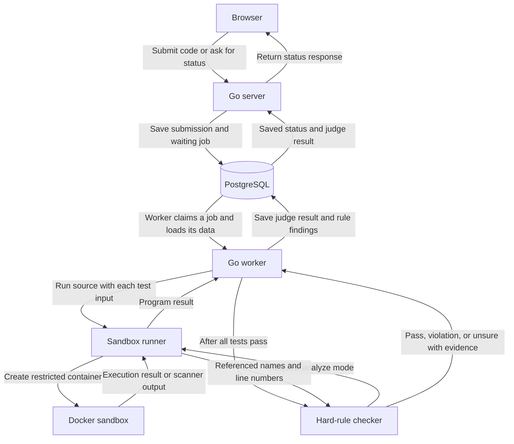

# How the server, worker, hard rules, and sandbox connect

## 1. Each part has one job

| Part | Simple job | Main file |
| --- | --- | --- |
| Server | Receives browser requests and returns saved data | [cmd/server/main.go](../../../backend/cmd/server/main.go) |
| Worker | Picks waiting submissions and judges them | [worker.go](../../../backend/internal/worker/worker.go) |
| Hard rules | Checks supported bans without AI | [check.go](../../../backend/internal/hardrules/check.go) |
| Sandbox runner | Creates restricted Docker containers for running or analyzing code | [runner.go](../../../backend/internal/sandbox/runner.go) |
| PostgreSQL | Stores submissions, waiting jobs, and results | Database tables |

- The server and worker are **two separate Go programs**.
- Hard rules and the sandbox runner are **Go packages called by the worker**.
- The C++ scanner itself runs inside a sandbox container.
- The server and worker share PostgreSQL; the server does not call the worker over HTTP.

## 2. Connection diagram



## 3. Follow one submission

- Example IDs below are shortened; real IDs are UUIDs.
- Lab rule: ``Do not call `std::sort` ``.
- Test input: `3 1`. Expected output: `1 3`.
- The student submits code that uses `std::sort` and prints `1 3`.

| Step | Who acts? | What happens? |
| --- | --- | --- |
| 1 | Server | Saves `submission-01` and a `pending` job together |
| 2 | Worker | Claims that job and changes it to `processing` |
| 3 | Worker → sandbox runner | Runs the source against the lab's tests |
| 4 | Sandbox → worker | Returns `Executed` and output `1 3` |
| 5 | Worker | Compares output with `1 3`; the test passes |
| 6 | Worker → hard rules | Requests assignment-rule checking |
| 7 | Hard rules → sandbox runner | Requests code analysis inside Docker |
| 8 | Scanner → hard rules | Reports a reference to `std::sort` and its line |
| 9 | Hard rules → worker | Returns a violation with the original source line |
| 10 | Worker | Saves Accepted, the separate rule violation, and job completion |
| 11 | Browser → server | Requests status and receives the saved judge result |

## 4. The exact calls that connect them

### Server → database

- The existing submission handler in [submission.go](../../../backend/internal/api/submission.go)
  saves the submission and job together.
- This leaves work in PostgreSQL even when the worker is stopped.

### Worker program → worker package

**File:** `cmd/worker/main.go`.

```go
w := worker.Worker{
    DB: db,
    Runner: sandbox.Runner{
        Image: os.Getenv("SANDBOX_IMAGE"),
    },
}
```

```go
found, err := w.ProcessOne(ctx)
```

- Give the worker its database connections and real sandbox runner.
- Repeatedly process one available job.

### Worker → sandbox: run mode

**File:** `internal/worker/worker.go`, function `judge()`.

```go
result, err := w.Runner.Run(ctx, source, test.input, "run")
```

- Compile and execute the student's source inside Docker.
- Return execution status and bounded output.
- The worker compares that output with the expected answer.

### Worker → hard rules

**File:** `internal/worker/worker.go`, function `judge()`.

```go
checks, err := hardrules.Check(ctx, w.Runner, source, constraints)
```

- Pass the same runner, source, and assignment rules to the checker.
- This happens after all execution tests pass.

### Hard rules → sandbox: analyze mode

**File:** `internal/hardrules/check.go`, function `Check()`.

```go
result, err := scanner.Run(ctx, source, "", "analyze")
```

- `scanner` is the sandbox runner supplied by the worker.
- Analyze mode runs the C++ scanner, not the student's `main()`.
- A scan is needed only when there is a supported ban-list rule.

### Worker → database: save results

**File:** `internal/worker/worker.go`, end of `judge()`.

```go
return w.Complete(ctx, job, "Accepted", "All test cases passed.", checks)
```

- Save the judge result and rule findings separately.
- Mark the job complete in the same grouped database save.
- The server can then read the result for the browser.

## 5. Run mode versus analyze mode

| Question | Run mode | Analyze mode |
| --- | --- | --- |
| Who requests it? | Worker | Hard-rule checker |
| What runs inside Docker? | Compiler, then the student's program | C++ scanner using Clang |
| Does the student's `main()` execute? | Yes, if compilation succeeds | No |
| What comes back? | Execution verdict and program output | Referenced names and source line numbers |
| What is checked next? | Does output match the expected answer? | Does a referenced name match a banned name? |

## 6. Why the results are separate

| Saved result | Example | Meaning |
| --- | --- | --- |
| Job status | `completed` | Processing has finished |
| Judge result | `Accepted` | Program passed the output tests |
| Constraint finding | `violation` | Code referenced banned `std::sort` |
| Published mark | Not produced here | Requires the separate TA review/publication workflow |

- Accepted and a constraint violation can both be correct.
- The diagram above describes the Member 1 base flow. Member 2 now adds optional
  semantic model checks between hard rules and the final result save.
- With model calls off, meaning-based rules remain `unsure` / `semantic_pending`.
- See [model checker flow](MODEL-CHECKER-FLOW.md) for the current model path.
- The student status endpoint does not expose protected constraint findings or deductions.

## 7. Read next

- [Worker flow](WORKER-FLOW.md): job ownership, retries, and saving results.
- [Hard-rule flow](HARD-RULE-FLOW.md): rule parsing, scanning, and evidence.
- [Model checker flow](MODEL-CHECKER-FLOW.md): Member 2 checking and evaluation.
- [Sandbox attacks](SANDBOX-ATTACKS.md): how the container protections are tested.
