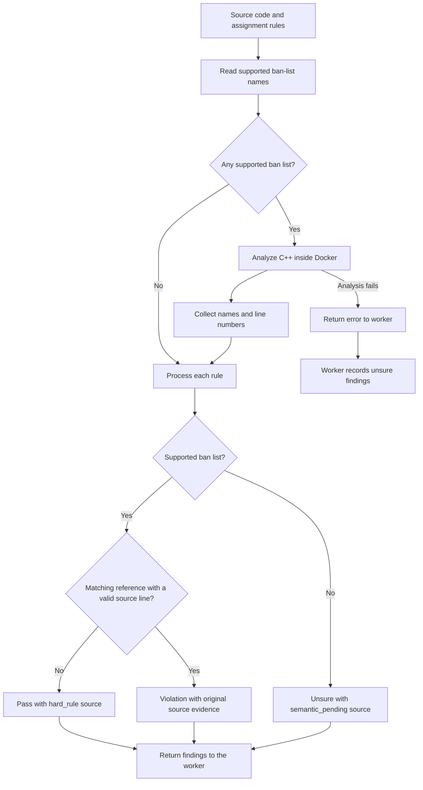

# Hard-rule checker: simple walkthrough

## 1. What does this checker do?

- It checks supported rules that ban named functions or references.
- Example: ``Do not call `std::sort` ``.
- It uses a C++ code scanner, not a plain text search of the student's code.
- It makes no model calls and chooses no deductions.
- The worker runs it after the program passes its output tests.
- See [WORKER-FLOW.md](WORKER-FLOW.md) for the surrounding judging flow.

| File | Responsibility |
| --- | --- |
| [check.go](../../../backend/internal/hardrules/check.go) | Reads rules, matches scanner findings, and creates verdicts |
| [check_test.go](../../../backend/internal/hardrules/check_test.go) | Tests rule format and tricky C++ examples |
| [scan.cpp](../../../sandbox/scan.cpp) | Uses Clang to find referenced names and source lines |
| [runner.go](../../../backend/internal/sandbox/runner.go) | Runs the scanner inside Docker |



## 2. Example input

- This is sample data, not a database record.

```cpp
#include <algorithm>
int main() {
    int a[] = {3, 1};
    std::sort(a, a + 2);
}
```

| Rule ID | Text |
| --- | --- |
| C1 | ``Do not call `std::sort` `` |
| C2 | `Use merge sort` |

- C1 can be checked by looking for the banned name.
- C2 needs a meaning-based check. Member 1 leaves it pending.
- The expected C1 evidence is line 4.

## 3. Understand the data types

**File:** `check.go`.

```go
type Constraint struct {
    ID   string `json:"id"`
    Text string `json:"text"`
}
```

```go
type Evidence struct {
    Line int    `json:"line"`
    Text string `json:"text"`
}
```

```go
type Verdict struct {
    ConstraintID string     `json:"constraintId"`
    Verdict      string     `json:"verdict"`
    Evidence     []Evidence `json:"evidence"`
    Source       string     `json:"source"`
}
```

| Field | Example | Meaning |
| --- | --- | --- |
| `ConstraintID` | `C1` | Which rule was checked |
| `Verdict` | `violation` | What the checker found |
| `Evidence` | Line 4 and its exact source text | Where the finding came from |
| `Source` | `hard_rule` | Which kind of checker produced it |

- There is no deduction field. The TA's deduction is stored separately.

## 4. Extract names from a supported rule

**File:** `check.go`, function `bannedNames()`.

```go
var backticks = regexp.MustCompile("`([^`]+)`")
```

```go
if !strings.HasPrefix(text, "Do not use") && !strings.HasPrefix(text, "Do not call") {
    return nil
}
```

```go
for _, match := range backticks.FindAllStringSubmatch(text, -1) {
    names = append(names, strings.TrimPrefix(match[1], "::"))
}
```

- Require one of the two exact starting phrases.
- Extract names enclosed in backticks.
- Remove a leading `::` from a name.
- The regular expression reads the rule text; Clang analyzes the student code.

| Rule text | Extracted names |
| --- | --- |
| ``Do not call `std::sort` `` | `std::sort` |
| ``Do not use `qsort` or `std::stable_sort` `` | `qsort`, `std::stable_sort` |
| `Use merge sort` | None |
| ``Use `std::sort` `` | None |
| `Do not call std::sort` | None: missing backticks |

```go
func IsBanList(text string) bool { return len(bannedNames(text)) > 0 }
```

- The worker also uses `IsBanList()` when recovering from analysis failure.

## 5. Decide whether a scanner run is needed

**File:** `check.go`, function `Check()`.

```go
needsScan := false
for _, c := range constraints {
    if len(bannedNames(c.Text)) > 0 {
        needsScan = true
    }
}
```

- Scan once if any rule contains a supported ban list.
- Our C1 requires a scan.
- If all rules are meaning-based, skip the scanner and leave them pending.

```go
result, err := scanner.Run(ctx, source, "", "analyze")
```

| Argument | Value |
| --- | --- |
| Source | The example C++ program |
| Standard input | Empty string |
| Mode | `analyze` |

- This mode runs `/usr/local/bin/scan` in the sandbox.
- It does not run the submitted program's `main()`.

## 6. Find the actual C++ names

**File:** `sandbox/scan.cpp`, function `visit()`.

```cpp
if ((kind == CXCursor_CallExpr || kind == CXCursor_DeclRefExpr) && file && text(clang_getFileName(file)) == "/work/main.cpp") {
    CXCursor target = clang_getCursorReferenced(cursor);
    if (!clang_Cursor_isNull(target)) {
        // A tab-separated name and line avoid serializing arbitrary student strings.
        std::cout << qualified(target) << '\t' << line << '\n';
    }
}
```

- Clang reads C++ structure and resolves the referenced declaration.
- The scanner collects calls and named references from the submitted file.
- Comments and string contents are not function calls or declaration references.
- The scanner can resolve `using std::sort` and macro-expanded calls.
- `qualified()` includes the surrounding namespace, such as `std::sort`.

Example output line:

```text
std::sort<TAB>4
```

- `<TAB>` represents a real tab character.
- Other references may also appear. This is one relevant line, not the entire output.

## 7. Turn scanner output into a lookup table

**File:** `check.go`, function `Check()`.

```go
calls := map[string][]int{}
```

```go
fields := strings.Split(line, "\t")
if len(fields) != 2 {
    continue
}
number, err := strconv.Atoi(fields[1])
if err == nil {
    calls[fields[0]] = append(calls[fields[0]], number)
}
```

| Name | Found at lines |
| --- | --- |
| `std::sort` | `[4]` |

- Split each output line into name and line number.
- Convert the number from text into an integer.
- Ignore lines with an unexpected format or a non-number line value.
- One name can appear on several lines.

## 8. Start each rule as pending

**File:** `check.go`, inside the rule loop.

```go
v := Verdict{ConstraintID: c.ID, Verdict: "unsure", Evidence: []Evidence{}, Source: "semantic_pending"}
```

- C2 has no supported ban list, so it keeps this result.
- `semantic_pending` means a meaning-based check has not been completed.
- It does not mean that a model already returned `unsure`.

For a supported ban list:

```go
names := bannedNames(c.Text)
if len(names) > 0 {
    v.Verdict = "pass"
    v.Source = "hard_rule"
    found := map[int]bool{}
```

- C1 starts as pass and changes to violation if a matching reference is found.
- `found` prevents duplicate evidence for the same source line.

## 9. Match names carefully

```go
short := called
if i := strings.LastIndex(short, "::"); i >= 0 {
    short = short[i+2:]
}
if called != name && (strings.Contains(name, "::") || short != name) {
    continue
}
```

| Banned name | Scanner name | Match? |
| --- | --- | --- |
| `std::sort` | `std::sort` | Yes |
| `std::sort` | `mine::sort` | No |
| `sort` | `std::sort` | Yes |
| `sort` | `mine::sort` | Yes |

- A rule naming `std::sort` is specific to that qualified name.
- A rule naming only `sort` is broader and matches names ending in `sort` after the final namespace separator.
- Clear TA rule wording matters.

## 10. Attach exact source evidence

```go
lines := strings.Split(string(source), "\n")
```

```go
if number >= 1 && number <= len(lines) && !found[number] {
    v.Verdict = "violation"
    v.Evidence = append(v.Evidence, Evidence{Line: number, Text: lines[number-1]})
    found[number] = true
}
```

- Check the line number is inside the submitted source.
- Source line numbers start at 1; Go list positions start at 0.
- Copy the original line rather than asking a scanner or model to rewrite it.
- Several matches on one line produce one evidence entry for that rule.

Our C1 result:

```json
{
  "constraintId": "C1",
  "verdict": "violation",
  "evidence": [
    { "line": 4, "text": "    std::sort(a, a + 2);" }
  ],
  "source": "hard_rule"
}
```

Our C2 result:

```json
{
  "constraintId": "C2",
  "verdict": "unsure",
  "evidence": [],
  "source": "semantic_pending"
}
```

## 11. What if analysis fails?

**File:** `check.go`, function `Check()`.

```go
if err != nil {
    return nil, err
}
if result.Verdict != "Executed" {
    return nil, fmt.Errorf("syntax analysis failed: %s", result.Verdict)
}
```

- The checker returns an error for runner failure or unsuccessful analysis.
- The worker catches that error and creates unsure findings.

| Rule type | Worker fallback verdict | Source |
| --- | --- | --- |
| Supported ban list | `unsure` | `hard_rule` |
| Other rule | `unsure` | `semantic_pending` |

- Failed analysis is not an automatic pass or deduction.
- Hard-rule failure is kept separate from work intended for the future model checker.

## 12. What the tests cover

**File:** `check_test.go`.

| Test function | Coverage |
| --- | --- |
| `TestBanListFormat` | Supported prefixes and extracting backtick names |
| `TestSyntaxTraps` | Seven C++ examples using the real scanner in Docker |

| C++ example | Expected C1 result |
| --- | --- |
| Real `std::sort` call | Violation |
| `std::sort` mentioned in a comment | Pass |
| Mentioned inside a string | Pass |
| Student's own `mine::sort` | Pass |
| `<algorithm>` included only for `std::swap` | Pass |
| Call through `using std::sort` | Violation |
| Call through a macro | Violation |

The test calls the same checker as the worker:

```go
got, err := Check(context.Background(), sandbox.Runner{}, []byte(test.source), []Constraint{{ID: "C1", Text: "Do not call `std::sort`"}, {ID: "C2", Text: "Use merge sort"}})
```

- It checks C1's expected verdict.
- It checks that C2 stays `semantic_pending`.
- For violations, it also requires one evidence entry with nonempty source text.
- This test does not currently compare the evidence text against a separate expected full line.

## 13. Run the checks

From the repository root:

```text
docker build -t leetkob-sandbox:pa3 sandbox
```

In PowerShell:

```powershell
$env:SANDBOX_TESTS = '1'
go -C backend test ./internal/hardrules -count=1 -v
```

- Without `SANDBOX_TESTS=1`, the rule-format test runs but the Docker syntax tests skip.
- No real model is needed.
- This guide describes the checks; writing it did not execute them.

## 14. Limits to remember

- This is a checker for supported named bans, not a complete proof of every assignment rule.
- It collects both call expressions and declaration references; it is not limited to executed runtime calls.
- Rule prefixes are checked exactly; different capitalization or leading spaces are not normalized here.
- A pass means no matching reference with usable evidence was found by this scanner.
- The current parser ignores malformed scanner lines; it does not fully validate scanner output as a schema.
- Source findings never choose deductions or publish marks.

| Word | Simple meaning |
| --- | --- |
| Hard rule | A supported check performed without a model |
| Qualified name | A name including its namespace, such as `std::sort` |
| Scanner | Program that reads C++ structure and reports names and lines |
| Evidence | Original source line supporting a finding |
| Semantic | About meaning, such as whether an algorithm is merge sort |
