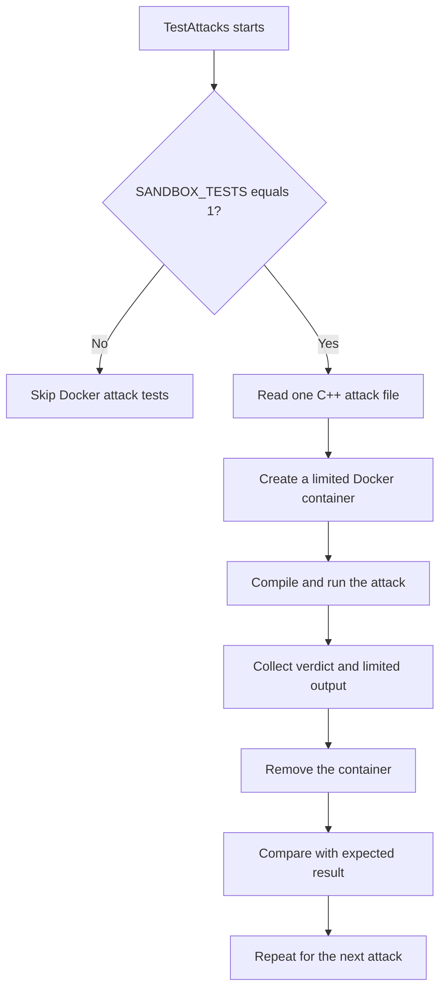

# Sandbox attack programs: simple walkthrough

## 1. What are these programs?

- They are small C++ programs that deliberately try to exceed a sandbox limit.
- Tests run them inside Docker, not directly on the host.
- A passing test means the expected protection worked for that attempt.
- The test suite checks specific attacks; it does not prove that every possible attack is blocked.
- See [WORKER-FLOW.md](WORKER-FLOW.md) for how normal student code reaches this runner.

| File or folder | Purpose |
| --- | --- |
| [testdata](../../../backend/internal/sandbox/testdata/) | Nine C++ attack programs |
| [runner_test.go](../../../backend/internal/sandbox/runner_test.go) | Runs attacks and checks their outcomes |
| [runner.go](../../../backend/internal/sandbox/runner.go) | Applies Docker limits and removes containers |

## 2. Overall flow



## 3. Test setup and example data

**File:** `runner_test.go`, function `TestAttacks()`.

```go
if os.Getenv("SANDBOX_TESTS") != "1" {
    t.Skip("set SANDBOX_TESTS=1 with Docker available")
}
```

- Real attack tests require Docker and the built sandbox image.
- Without this setting, a normal Go test run skips them.

```go
source, err := os.ReadFile("testdata/" + test.name + ".cpp")
```

```go
result, err := (Runner{Wall: 8 * time.Second}).Run(context.Background(), source, "", "run")
```

| Argument | Example |
| --- | --- |
| `test.name` | `network` |
| File loaded | `testdata/network.cpp` |
| Input | Empty string |
| Mode | `run`: compile and execute |
| Overall timeout | 8 seconds for these tests |

- The runner's normal default is 20 seconds. This test overrides it with 8 seconds.
- Each attack gets a fresh container.

## 4. Network access: network.cpp

**File:** [network.cpp](../../../backend/internal/sandbox/testdata/network.cpp).

```cpp
address.sin_port = htons(443);
inet_pton(AF_INET, "1.1.1.1", &address.sin_addr);
std::cout << (connect(fd, (sockaddr*)&address, sizeof(address)) == 0 ? "ESCAPED" : "BLOCKED");
```

- Try to open a TCP connection to `1.1.1.1:443`.
- Print `ESCAPED` if the connection succeeds.
- Print `BLOCKED` if it fails.
- The runner uses `--network none`.

| Expected verdict | Expected output |
| --- | --- |
| `Executed` | `BLOCKED` |

- A failed connection alone can also happen for other reasons. The separate Docker-settings test checks that networking is explicitly disabled.

## 5. CPU usage: cpu.cpp

**File:** [cpu.cpp](../../../backend/internal/sandbox/testdata/cpu.cpp).

```cpp
int main() { for (volatile unsigned long long n = 0;; ++n) {} }
```

- Count forever without waiting.
- `volatile` helps prevent the compiler from removing the work.
- The program is launched with `prlimit --cpu=2:2`.
- The container also has a CPU allocation limit and an outer CPU-time limit.

| What it tests | Expected verdict |
| --- | --- |
| A program cannot keep using CPU forever | `Time Limit Exceeded` |

## 6. Elapsed time: wall.cpp

**File:** [wall.cpp](../../../backend/internal/sandbox/testdata/wall.cpp).

```cpp
int main() { sleep(60); }
```

- Sleep for 60 seconds.
- Sleeping uses little CPU, so a CPU limit alone is not enough.
- The test runner's 8-second overall timeout stops the container.
- That timeout includes sandbox setup, compilation, and execution.

| Expected verdict | Extra check |
| --- | --- |
| `Time Limit Exceeded` | The container no longer exists |

The extra check in `runner_test.go`:

```go
if err := exec.Command("docker", "inspect", result.Container).Run(); err == nil {
    t.Fatal("wall timeout left the container alive")
}
```

- A successful inspect would mean the container still exists, so the test fails.

## 7. Memory usage: memory.cpp

**File:** [memory.cpp](../../../backend/internal/sandbox/testdata/memory.cpp).

```cpp
volatile unsigned char* memory = (volatile unsigned char*)malloc(1024ULL * 1024 * 1024);
if (!memory) return 1;
for (unsigned long long i = 0; i < 1024ULL * 1024 * 1024; ++i) memory[i] = 123;
```

```cpp
unsigned long long total = 0;
for (unsigned long long i = 0; i < 1024ULL * 1024 * 1024; ++i) total += memory[i];
std::cout << total;
```

- Request 1 GiB of memory.
- Write to the memory so this is real memory use, not just an address reservation.
- Read it back so the work cannot simply be discarded.
- Docker allows only 256 MB, with no additional swap allowance.

| Attempt | Expected verdict |
| --- | --- |
| Use much more than the memory limit | `Memory Limit Exceeded` |

- The runner checks Docker's `OOMKilled` flag to identify this result.

## 8. Too many processes: process.cpp

**File:** [process.cpp](../../../backend/internal/sandbox/testdata/process.cpp).

```cpp
for (int i = 0; i < 64; ++i) {
    pid_t pid = fork();
    if (pid < 0) { std::cout << "BLOCKED"; break; }
    if (pid == 0) { sleep(2); _exit(0); }
    ++children;
}
while (children-- > 0) wait(nullptr);
```

- Try to create 64 child processes.
- Keep children alive briefly so they overlap.
- Docker limits the container to 32 processes/tasks, including existing ones.
- `fork()` should fail before all 64 children are created.
- The parent waits for children to finish.

| Expected verdict | Expected output |
| --- | --- |
| `Executed` | `BLOCKED` |

## 9. Too much output: output.cpp

**File:** [output.cpp](../../../backend/internal/sandbox/testdata/output.cpp).

```cpp
int main() { char buffer[4096]{}; for (;;) write(1, buffer, sizeof(buffer)); }
```

- Write 4,096-byte blocks to standard output forever.
- Output can be binary; it does not need readable text to consume memory.
- The runner shares a 64 KiB limit across standard output and error output.
- When the buffer limit is exceeded, it cancels execution and removes the container.

| Expected verdict | Maximum saved output |
| --- | --- |
| `Output Limit Exceeded` | 65,536 bytes |

The suite also checks:

```go
if len(result.Output) > 64*1024 {
    t.Fatal("output limit exceeded")
}
```

## 10. Root access: user.cpp

**File:** [user.cpp](../../../backend/internal/sandbox/testdata/user.cpp).

```cpp
int main() { std::cout << (getuid() != 0 && setuid(0) != 0 ? "BLOCKED" : "ESCAPED"); }
```

- Check that the current user is not root: `getuid() != 0`.
- Try to become root: `setuid(0)`.
- Both checks must show that root access is unavailable.
- Docker uses user `65534:65534`, drops capabilities, and disables new privileges.

| Expected verdict | Expected output |
| --- | --- |
| `Executed` | `BLOCKED` |

## 11. Host files and Docker socket: mounts.cpp

**File:** [mounts.cpp](../../../backend/internal/sandbox/testdata/mounts.cpp).

```cpp
std::strcpy(address.sun_path, "/var/run/docker.sock");
int fd = socket(AF_UNIX, SOCK_STREAM, 0);
bool socketVisible = connect(fd, (sockaddr*)&address, sizeof(address)) == 0;
bool hostVisible = std::ifstream("/host/etc/passwd").good() || std::ifstream("/run/host/etc/passwd").good();
std::cout << (socketVisible || hostVisible ? "ESCAPED" : "BLOCKED");
```

- Try connecting to the Docker socket.
- Try reading files at two possible host-mount paths.
- Any successful check prints `ESCAPED`.
- The runner sends code through standard input instead of mounting host folders.

| Expected verdict | Expected output |
| --- | --- |
| `Executed` | `BLOCKED` |

- This checks those specific paths. The settings test separately rejects host-volume and mount flags.

## 12. Secrets: secrets.cpp

**File:** [secrets.cpp](../../../backend/internal/sandbox/testdata/secrets.cpp).

Check secret-file paths during compilation:

```cpp
#if __has_include("/app/.env") || __has_include("/work/.env") || __has_include("/run/secrets/model_api_key")
#error Sandbox exposed a secret file to the compiler
#endif
```

Check environment variables and another file path during execution:

```cpp
bool exposed = getenv("MODEL_API_KEY") || getenv("GEMINI_API_KEY") || getenv("DATABASE_URL");
exposed |= std::ifstream("/proc/1/root/app/.env").good();
std::cout << (exposed ? "ESCAPED" : "BLOCKED");
```

- Secret files must not be visible to the compiler.
- API keys and database settings must not be passed into the container.
- The runner does not forward the API or worker environment.
- A compilation error also fails this attack test: the expected outcome is successful execution printing `BLOCKED`.

## 13. How the test decides pass or fail

**File:** `runner_test.go`, function `TestAttacks()`.

```go
if test.expected == "BLOCKED" {
    if result.Verdict != "Executed" || strings.TrimSpace(result.Output) != "BLOCKED" {
        t.Fatalf("attack escaped or test malfunctioned: %+v", result)
    }
} else if result.Verdict != test.expected {
    t.Fatalf("want %s, got %+v", test.expected, result)
}
```

| Program | Expected outcome |
| --- | --- |
| `network`, `process`, `user`, `mounts`, `secrets` | Executed and printed `BLOCKED` |
| `cpu`, `wall` | Time Limit Exceeded |
| `memory` | Memory Limit Exceeded |
| `output` | Output Limit Exceeded |

- A crashed program is not automatically a passing security test.
- The suite requires the specific expected outcome.

## 14. Run the tests

- From the repository root, build the sandbox first:

```text
docker build -t leetkob-sandbox:pa3 sandbox
```

- In PowerShell, enable and run the sandbox tests:

```powershell
$env:SANDBOX_TESTS = '1'
go -C backend test ./internal/sandbox -count=1 -v
```

- Run these through the sandbox test suite, not as standalone host programs.
- This guide describes the tests; writing it did not execute the attacks.

## 15. Words used here

| Word | Simple meaning |
| --- | --- |
| Sandbox | Restricted environment for untrusted code |
| CPU time | Time spent actively executing work |
| Wall time | Total elapsed time, including waiting |
| Process | A running program instance |
| Root | A user with very high permissions |
| Docker socket | A connection used to control Docker |
| Swap | Extra memory space backed by disk |
