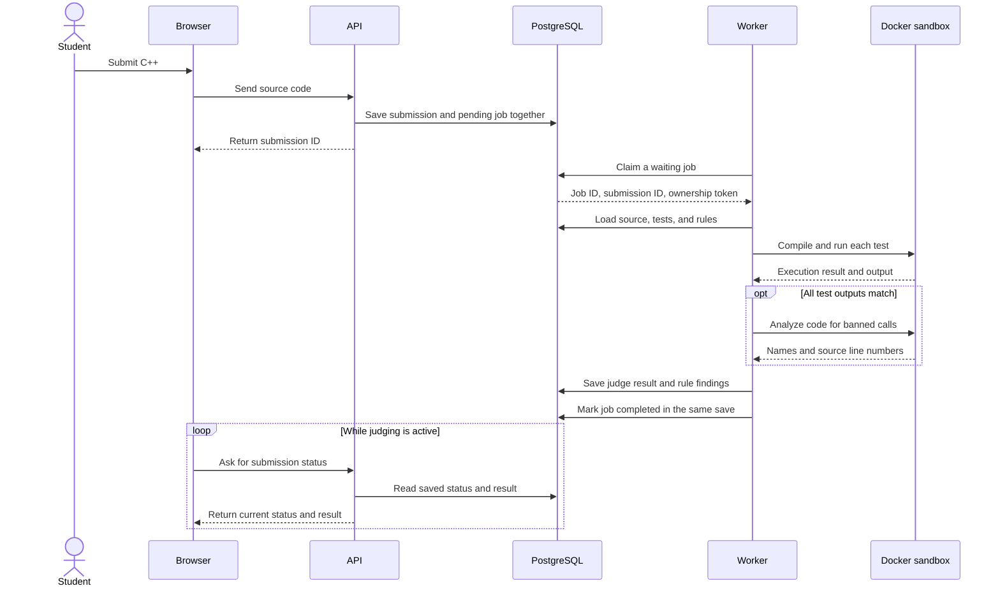
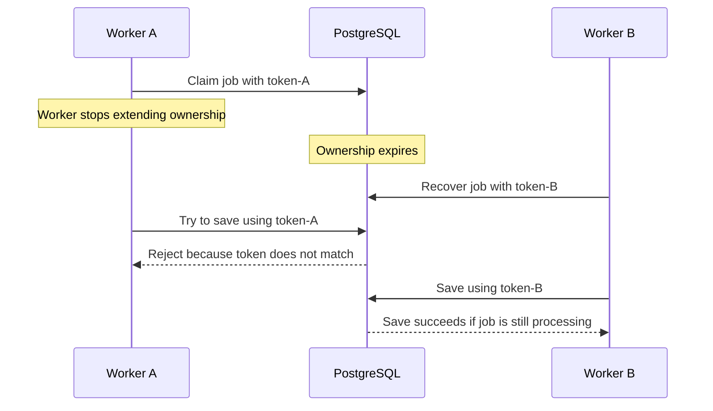
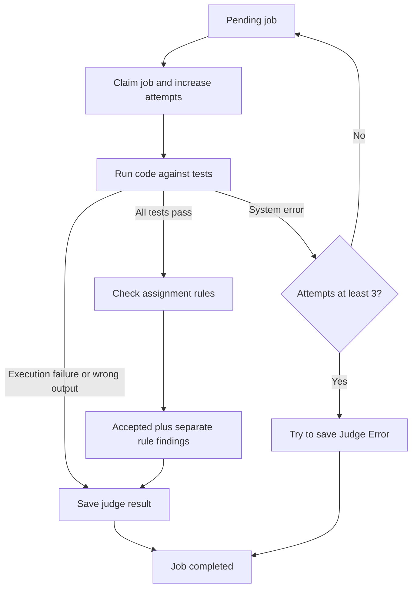

# Worker flow: from submitted code to a saved result

## 1. What is a worker?

- A worker is a separate program that handles jobs in the background.
- The API receives a submission and saves it with a job in PostgreSQL.
- The worker reads that job, runs the code, and saves the result.
- The browser asks the API for the result. It does not talk to the worker directly.
- PostgreSQL stores the queue. There is no separate queue service here.

| File | Responsibility |
| --- | --- |
| [cmd/worker/main.go](../../../backend/cmd/worker/main.go) | Starts the worker and keeps looking for jobs |
| [worker.go](../../../backend/internal/worker/worker.go) | Claims a job, runs tests, checks rules, and saves results |
| [worker_test.go](../../../backend/internal/worker/worker_test.go) | Checks restart, ownership, and result-saving behavior |
| [runner.go](../../../backend/internal/sandbox/runner.go) | Runs or analyzes C++ inside Docker |
| [check.go](../../../backend/internal/hardrules/check.go) | Checks supported banned-function rules |



## 2. Example data

- These are sample records, not data read from your database.
- IDs are shortened below. Real IDs are UUIDs.

| Item | Example value |
| --- | --- |
| Student | `student@example.test` |
| Lab | `lab-01` |
| Submission | `submission-01` |
| Job | `job-01` |
| Test input | `3 1` |
| Expected output | `1 3` |
| Rule C1 | ``Do not call `std::sort` `` |
| Rule C2 | `Use merge sort` |

The submitted program:

```cpp
#include <algorithm>
#include <iostream>
int main() {
    int a, b;
    std::cin >> a >> b;
    int values[] = {a, b};
    std::sort(values, values + 2);
    std::cout << values[0] << " " << values[1];
}
```

- This prints the right output for the example test.
- Line 7 breaks C1.
- A correct output does not prove that all assignment rules were followed.

## 3. Start the worker

**File:** `cmd/worker/main.go`, function `main()`.

```go
url := os.Getenv("DATABASE_URL")
```

```go
db, err := pgxpool.New(ctx, url)
```

- Read the database address from the process environment.
- Create a pool of reusable database connections.
- The worker command does not automatically load `.env`; the server's `env.go`
  belongs to a different command.

```go
w := worker.Worker{
    DB: db,
    Runner: sandbox.Runner{
        Image: os.Getenv("SANDBOX_IMAGE"),
    },
}
```

| Field | Meaning |
| --- | --- |
| `DB` | Database connections used to read jobs and save results |
| `Runner` | Tool that runs and analyzes code in Docker |
| `Image` | Sandbox Docker image; an empty value uses the runner's default |

## 4. Keep asking for a job

**File:** `cmd/worker/main.go`, inside `main()`.

```go
for ctx.Err() == nil {
    found, err := w.ProcessOne(ctx)
```

- `ctx` carries the shutdown request.
- Keep working until shutdown is requested.
- Each call tries to process one job.

When idle or after an error:

```go
if !found || err != nil {
    select {
    case <-ctx.Done():
    case <-time.After(time.Second):
    }
}
```

| Result | Next action |
| --- | --- |
| No job found | Wait one second, then check again |
| Job handled without error | Look for the next job immediately |
| Error returned | Log the error, wait, then check again |
| Shutdown requested | Leave the loop |

## 5. Claim the waiting job

**File:** `worker.go`, function `ProcessOne()`.

```go
job, err := w.Claim(ctx)

if errors.Is(err, pgx.ErrNoRows) {
    return false, nil
}
```

- `Claim()` tries to take one job.
- `pgx.ErrNoRows` means there was no available job.
- `false, nil` means “no work found, no error.”

**File:** `worker.go`, function `Claim()`.

```go
token := uuid.NewString()
var job Job
```

The SQL inside `Claim()`:

```sql
UPDATE jobs SET status='processing', lease_token=$1,
 leased_until=now()+interval '60 seconds', attempts=attempts+1 WHERE id=(
 SELECT id FROM jobs WHERE status='pending' OR (status='processing' AND leased_until<now())
 ORDER BY created_at,id FOR UPDATE SKIP LOCKED LIMIT 1)
 RETURNING id::text,submission_id::text,lease_token::text
```

| SQL part | Simple meaning |
| --- | --- |
| `status='pending'` | Pick a waiting job |
| Expired `processing` condition | Also allow recovery after a worker stops |
| `ORDER BY created_at,id` | Prefer older jobs |
| `SKIP LOCKED` | Skip a job another worker is already locking |
| `LIMIT 1` | Take one job |
| `lease_token` | New ownership ID for this attempt |
| `leased_until` | Ownership lasts 60 seconds unless extended |
| `attempts+1` | Count this processing attempt |

Example database change:

| Field | Before | After |
| --- | --- | --- |
| Job ID | `job-01` | `job-01` |
| Status | `pending` | `processing` |
| Attempts | `0` | `1` |
| Token | Empty | `token-A` |
| Ownership expiry | Empty | 60 seconds from now |

## 6. Keep ownership while running

**File:** `worker.go`, function `ProcessOne()`.

```go
workCtx, cancel := context.WithCancel(ctx)
defer cancel()
```

- Create a stop signal for this job's work.
- `cancel()` tells that work to stop.

```go
done := make(chan struct{})
defer close(done)
go func() {
    ticker := time.NewTicker(10 * time.Second)
    defer ticker.Stop()
```

- `go func()` starts a small background task.
- Every 10 seconds, it extends the job's ownership.
- `done` tells this background task to stop when processing finishes.

The extension query:

```sql
UPDATE jobs SET leased_until=now()+interval '60 seconds'
WHERE id=$1 AND lease_token=$2 AND status='processing'
```

```go
if e != nil || tag.RowsAffected() != 1 {
    cancel()
    return
}
```

- Only the current owner can extend ownership.
- A database error or changed ownership stops this worker's work.

## 7. Load source and tests

**File:** `worker.go`, function `ProcessOne()`.

```go
err = w.judge(workCtx, job)
```

**File:** `worker.go`, function `judge()`.

```go
var source []byte
var lab string

if err := w.DB.QueryRow(ctx, "SELECT source,lab_id::text FROM submissions WHERE id=$1", job.SubmissionID).Scan(&source, &lab); err != nil {
    return err
}
```

- Look up `submission-01`.
- Copy its code into `source` and its lab ID into `lab`.
- `[]byte` means the source is stored as bytes.
- `Scan()` copies database values into Go variables.

```go
rows, err := w.DB.Query(ctx, "SELECT input,expected_output FROM lab_tests WHERE lab_id=$1 ORDER BY id", lab)
```

```go
type testCase struct{ input, expected string }
tests := []testCase{}
```

```go
tests = append(tests, test)
```

- The query reads the lab's private tests.
- The loop copies each row into `test` and adds it to `tests`.
- Our example contains one pair: input `3 1`, expected output `1 3`.

## 8. Run each test

**File:** `worker.go`, function `judge()`.

```go
for i, test := range tests {
    result, err := w.Runner.Run(ctx, source, test.input, "run")
```

| Value passed to the runner | Example |
| --- | --- |
| `source` | Student's C++ program |
| `test.input` | `3 1` |
| `"run"` | Compile and execute mode |

The sandbox returns a result such as:

```text
Verdict: Executed
Output:  1 3
```

- `Executed` means the program finished successfully.
- The worker still has to check its answer.
- The runner creates a new container for each call; the current loop calls it for
  each test case.

```go
if result.Verdict != "Executed" {
    return w.Complete(ctx, job, result.Verdict, fmt.Sprintf("Test case %d did not complete successfully.", i+1), nil)
}
```

- A compilation, runtime, time-limit, or memory-limit result ends testing early.
- `Complete()` saves that result.
- `nil` means no constraint findings are supplied.

## 9. Compare the output

**File:** `worker.go`, function `judge()`.

```go
if normalize(result.Output) != normalize(test.expected) {
    return w.Complete(ctx, job, "Wrong Answer", fmt.Sprintf("Output did not match test case %d.", i+1), nil)
}
```

```go
func normalize(text string) string { return strings.Join(strings.Fields(text), " ") }
```

| Actual | Expected | Outcome |
| --- | --- | --- |
| `1 3` | `1 3` | Match |
| Extra spaces between `1` and `3`, plus a final newline | `1 3` | Match |
| `3 1` | `1 3` | Wrong Answer |

- `normalize()` ignores differences in spaces and line breaks.
- Our sample passes its test.

## 10. Check assignment rules

**File:** `worker.go`, function `judge()`.

```go
rows, err = w.DB.Query(ctx, "SELECT id::text,description FROM lab_constraints WHERE lab_id=$1 ORDER BY id", lab)
```

```go
constraints = append(constraints, c)
```

```go
checks, err := hardrules.Check(ctx, w.Runner, source, constraints)
```

- Read each rule's ID and description.
- Build the rule list.
- Ask the hard-rule checker to inspect the code.
- This step happens only after all execution tests pass.

| Rule | Finding | Source | Evidence |
| --- | --- | --- | --- |
| C1: banned `std::sort` | `violation` | `hard_rule` | Line 7 from the submitted source |
| C2: use merge sort | `unsure` | `semantic_pending` | Empty |

- Member 1 does not make a real model call here.
- Meaning-based rules remain pending for Member 2.
- If analysis fails, the worker makes the findings `unsure`:

```go
checks = append(checks, hardrules.Verdict{ConstraintID: c.ID, Verdict: "unsure", Evidence: []hardrules.Evidence{}, Source: source})
```

## 11. Save results together

**File:** `worker.go`, end of `judge()`.

```go
return w.Complete(ctx, job, "Accepted", "All test cases passed.", checks)
```

**File:** `worker.go`, function `Complete()`.

```go
tx, err := w.DB.Begin(ctx)
```

```go
defer tx.Rollback(ctx)
```

- Start a grouped save, called a transaction.
- A failure before commit leaves none of these result changes saved.

Check ownership before writing:

```go
err = tx.QueryRow(ctx, "SELECT lease_token::text FROM jobs WHERE id=$1 AND status='processing' FOR UPDATE", job.ID).Scan(&token)

if errors.Is(err, pgx.ErrNoRows) || (err == nil && token != job.Token) {
    return ErrLeaseLost
}
```

- Lock the job row while saving.
- Reject an old worker if its token no longer matches.

The save statements write to:

| Table | Saved example |
| --- | --- |
| `judge_results` | `submission-01`, `Accepted`, `All test cases passed.` |
| `constraint_verdicts` | C1 violation with source-line evidence |
| `constraint_verdicts` | C2 unsure with source `semantic_pending` |

Evidence is converted to JSON first:

```go
evidence, err := json.Marshal(check.Evidence)
```

- `INSERT ... ON CONFLICT ... DO UPDATE` keeps one judge result per submission
  and one finding per submission/rule pair.
- Existing rows are updated rather than duplicated.

Finish the save:

```go
_, err = tx.Exec(ctx, "UPDATE jobs SET status='completed',leased_until=NULL WHERE id=$1", job.ID)
```

```go
return tx.Commit(ctx)
```

- `Commit()` makes the whole grouped save final.
- The job is now `completed`.
- Completed means processing ended; a completed job may contain Wrong Answer or
  Judge Error as well as Accepted.
- No mark is published by this code.

## 12. What if a worker stops?



- The recovery condition is inside `Claim()`:

```sql
status='pending' OR (status='processing' AND leased_until<now())
```

- The job remains in PostgreSQL when a worker stops.
- Another worker can run it again after ownership expires.
- The old token cannot overwrite the new owner's result.
- This protects stored results; it does not promise the code runs only once.

## 13. What if Docker or the database fails?

**File:** `worker.go`, error branch in `ProcessOne()`.

```go
cleanup, stop := context.WithTimeout(context.Background(), 5*time.Second)
defer stop()
var attempts int
```

- Use a fresh five-second window to try to save recovery changes.
- This can still run after the original job's context was cancelled.

```go
if e := w.DB.QueryRow(cleanup, "SELECT attempts FROM jobs WHERE id=$1", job.ID).Scan(&attempts); e == nil && attempts >= 3 {
    _ = w.Complete(cleanup, job, "Judge Error", "Judging could not be completed. Contact the TA.", nil)
} else {
    _, _ = w.DB.Exec(cleanup, "UPDATE jobs SET status='pending',leased_until=NULL WHERE id=$1 AND lease_token=$2 AND status='processing'", job.ID, job.Token)
}
```

| Situation | Next action |
| --- | --- |
| System failure before attempt 3 | Try to put the job back into `pending` |
| System failure with attempt count at least 3 | Try to save `Judge Error` |
| Database remains unavailable | Recovery writes may fail; expired ownership allows later recovery |
| Student produces incorrect output | Save Wrong Answer directly; this is not a system retry |
| Rule analysis fails after tests pass | Save Accepted with unsure rule findings |



- The diagram assumes the recovery save succeeds.
- Any stopped worker can also leave a processing job for later expiry/recovery.

## 14. Important words

| Word | Simple meaning |
| --- | --- |
| Queue | Jobs waiting in PostgreSQL |
| Claim | Take temporary ownership of a job |
| Lease | That temporary ownership period |
| Token | Unique ID proving which assignment the worker owns |
| Heartbeat | Regularly extending ownership while still working |
| Transaction | Several database changes saved together |
| Verdict | A result such as Accepted or Wrong Answer |
| Evidence | Original source lines supporting a rule finding |

## 15. Tests to read next

**File:** [worker_test.go](../../../backend/internal/worker/worker_test.go).

| Test | What it proves |
| --- | --- |
| `queued work survives absent worker and is stored once` | Jobs wait safely while no worker runs; processing saves one result set |
| `expired lease fences old worker` | Recovery changes the token; an old or duplicate completion is rejected |
| `analysis failure remains unsure without sending bans to model` | Failed analysis remains unsure and preserves hard-rule versus pending-model sources |

- The worker tests use a fake runner by default.
- Set `TEST_DATABASE_URL` to run the database-backed worker tests.
- With `SANDBOX_TESTS=1`, the relevant tests use the real Docker runner instead.
- No test needs to call a real model.

## 16. Final result for the example

| Question | Answer |
| --- | --- |
| Did the program print the expected output? | Yes: `1 3` |
| Judge verdict | Accepted |
| Did it obey the ban on `std::sort`? | No: violation at line 7 |
| Did Member 1 prove it used merge sort? | No: semantic checking is pending |
| Did the worker publish marks or apply a deduction? | No |

- Accepted describes the judge tests.
- Constraint findings describe assignment rules.
- The TA reviews findings before they affect published marks.
