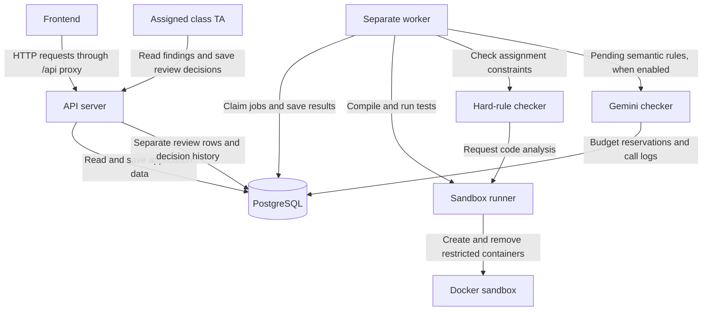

# Current backend structure

- **Language:** Go 1.26 or newer.
- **HTTP:** Chi router with SCS server-side sessions.
- **Database:** PostgreSQL 17, accessed through `pgx`.
- **Judging:** Separate worker and restricted Docker containers.
- **Current scope:** Class setup, labs, submissions, judging, optional model findings, and TA review with separate decisions/history.
- **Baseline:** Final PA3 implementation, reviewed November 25, 2026. PA4 sampling and Publish are planned in [REVIEW-PUBLISH-FLOW.md](REVIEW-PUBLISH-FLOW.md).

## Main parts



- The API and worker are separate running programs.
- They communicate through database rows, not direct HTTP calls.
- Hard rules and the sandbox runner are packages used by the worker.
- There is no separate queue service: pending work lives in `jobs`.

## Folder layout

```text
backend/
  cmd/
    server/          # Start HTTP API and sessions; load local .env
    worker/          # Start the background judging loop
    migrate/         # Apply database migrations
    create-user/     # Create an initial account
    checker/         # Write prediction JSONL for any compatible dataset
  internal/
    api/             # HTTP routes, access checks, and database operations
    worker/          # Job ownership, judging, retries, and result saving
    sandbox/         # Docker runner and attack tests
      testdata/      # Nine C++ attack programs
    hardrules/       # Supported ban-list checks and tests
    semantic/        # Gemini adapter, prompt cleaning, verdict validation
    localenv/        # Shared automatic local environment loading
    checker/         # Dataset reader and isolated-image syntax scanner
  migrations/        # Database changes, applied in version order
  go.mod             # Go version and dependency list
  go.sum             # Dependency checksums
```

## Commands and configuration

| Entry point | Command from repository root | Purpose |
| --- | --- | --- |
| `cmd/server/main.go` | `go -C backend run ./cmd/server` | Start the API, normally on port 8080 |
| `cmd/worker/main.go` | `go -C backend run ./cmd/worker` | Repeatedly process judging jobs |
| `cmd/worker/main.go --once` | `go -C backend run ./cmd/worker --once` | Process at most one available job and exit |
| `cmd/migrate/main.go` | `go -C backend run ./cmd/migrate` | Apply missing migrations |
| `cmd/create-user/main.go` | `go -C backend run ./cmd/create-user` | Create an account using environment settings |
| `cmd/checker/main.go` | `go -C backend run ./cmd/checker --data ../eval/official --predictions <new-file>` | Standalone dataset predictions; Docker syntax runner by default |

- The API, worker, and checker use `localenv.Load` to read `.env` from the current directory or its parent.
- Existing process environment variables take precedence over that file.
- The migration and account commands still require settings loaded into their
  process environment.
- Migration SQL paths are relative to the backend working directory. The `-C backend`
  commands above select that directory.
- Checker input/output paths are also relative to `backend/` when using `go -C backend`.
- With real calls enabled, the checker also requires `--call-log <new-file>`.
  Existing prediction and audit files are refused to preserve earlier evidence.

| Setting | Used for |
| --- | --- |
| `DATABASE_URL` | Database access for API, worker, migrations, and account creation; the standalone checker needs no database |
| `APP_ORIGIN` | Allowed frontend origin for state-changing API requests |
| `API_PORT` | API listening port; defaults to 8080 |
| `COOKIE_SECURE` | Use `false` for local HTTP; secure cookies otherwise |
| `SANDBOX_IMAGE` | Worker sandbox image; defaults to `leetkob-sandbox:pa3` |
| `USER_EMAIL`, `USER_PASSWORD`, `USER_ROLE` | Account creation; password must be at least 12 bytes |
| `MODEL_OFF` | Worker/checker calls are off when unset or `1`; `0` explicitly enables them |
| `MODEL_NAME`, `MODEL_API_KEY` | Supported Gemini model and private provider key; only the worker or enabled checker needs these |
| `MODEL_LAB_BUDGET_MICRO_USD` | Optional budget in microdollars; shared per lab in the worker, or per problem/run in the checker |

## API files

| File in `internal/api/` | Responsibility |
| --- | --- |
| `server.go` | Registers routes, wraps them with session handling, checks request origins |
| `auth.go` | Checks login credentials, starts a fresh session, and logs out |
| `password.go` | Creates and verifies Argon2id password hashes |
| `problem.go` | Writes consistent JSON error responses |
| `enrollment.go` | Lets an admin enroll an existing student in a lab |
| `lab.go` | Lets an assigned TA create a lab, tests, constraints, and enrollments together |
| `workspace.go` | Current identity, class creation/listing, accessible lab listing, and submission status |
| `browse.go` | Admin account search, protected class details, and student submission history |
| `submission.go` | Validates submissions and retry keys; saves submission, job, and retry response together |
| `review.go` | Class-scoped TA queue, read-only earlier submissions, separate TA decisions and history |
| `api_test.go` | Password checks, HTTP contracts, ownership checks, and database-backed flows |

## Routes and access

- These are direct Go routes on port 8080.
- Browser requests use `/api` before these paths. Vite and Caddy remove that prefix.
- For example, the browser requests `/api/me`; Go receives `/me`.

| Endpoint | Access and result |
| --- | --- |
| `POST /auth/login` | Email/password and valid Origin; creates a session |
| `POST /auth/logout` | Valid Origin; destroys the session |
| `GET /me` | Signed-in account; returns ID and role |
| `GET /people?q=...` | Admin; up to 200 account matches without password data |
| `POST /classes` | Admin and valid Origin; assigns existing TA/students |
| `GET /classes` | User's classes; admin sees all |
| `GET /classes/{classId}` | Admin or member; students do not receive the roster |
| `POST /classes/{classId}/labs` | Assigned TA and valid Origin |
| `GET /labs` | Assigned TA or enrolled student; excludes private tests and deductions |
| `POST /labs/{labId}/enrollments` | Admin and valid Origin |
| `POST /labs/{labId}/submissions` | Enrolled student and valid Origin; requires retry key |
| `GET /submissions` | Student's latest 200 submissions |
| `GET /submissions/{submissionId}` | Submission owner or assigned TA; status, judge result, source, and lab ID |
| `GET /labs/{labId}/review-queue` | Assigned class TA; findings for latest counted Accepted submissions, reasons, deductions and TA decisions |
| `GET /labs/{labId}/earlier-submissions` | Assigned class TA; read-only source, judge results and findings for replaced submissions |
| `POST /labs/{labId}/submissions/{submissionId}/constraints/{constraintId}/review` | Assigned class TA and valid Origin; records a decision for a counted Accepted submission and its history |

- Roles and ownership are checked on the server, not trusted from browser inputs.
- Protected constraint findings and deductions are excluded from student results.
- Account creation currently uses the CLI, not an HTTP endpoint.
- Review routes return 403 for non-TA roles and 404 for an unknown lab or another class's TA. Review writes reject stale submissions and nonmatching evidence.
- There is no Publish or student marks route. The current queue returns all constraint findings for counted Accepted submissions; it does not yet draw PA4's random 10% pass sample.

## Worker and judging

| File | Responsibility |
| --- | --- |
| `internal/worker/worker.go` | Claim jobs, run tests, compare output, check rules, save results |
| `internal/sandbox/runner.go` | Create a fresh restricted container for each run or analysis |
| `internal/hardrules/check.go` | Parse supported bans and match scanner findings to source lines |
| `internal/semantic/` | Remove comments, redact known identities, call Gemini, validate findings and evidence |
| `internal/worker/model.go` | Reserve persistent per-lab budget and save protected model call logs |
| `internal/localenv/` | Load local `.env` automatically for API and worker |
| `sandbox/scan.cpp` outside `backend/` | Clang-based C++ scanner used inside the sandbox |

- Idle/error queue checks wait one second. Successful jobs are followed immediately
  by the next queue check.
- Job ownership lasts 60 seconds and is extended every 10 seconds while working.
- Expired jobs can be recovered; ownership tokens reject outdated worker writes.
- Output comparison ignores differences in whitespace between tokens.
- Only submissions passing all execution tests proceed to constraint checking.
- Supported bans start with `Do not use` or `Do not call`, with names in backticks.
- The Clang scanner covers calls, references, loop/goto statements, and types,
  including container aliases. Header contents alone do not count as student use.
- Other requirements stay `unsure` with source `semantic_pending` when calls are off.
- With `MODEL_OFF=0`, Accepted code reaches Gemini with validated findings and
  a persistent per-lab cost cap. Failed attempts become `unsure` with source `model`.
- Accepted and a separate rule violation can both be saved for one submission.

## Model checking and evaluation

| Control | Current behavior |
| --- | --- |
| Prompt | Statement, pending semantic constraints, and code as numbered `{line, text}` objects; comments and known account identifiers removed |
| Hard-rule findings | Preserved; never sent to Gemini for another decision |
| Deadline | Bounds checking time, including budget/rate waiting |
| Validation | Required IDs/verdicts, strict JSON fields, and matching evidence lines |
| Invalid response or provider error | Unsure; no automatic provider retry |
| Rate | Spaces request starts within one process |
| Budget | Reserve maximum estimated cost before network access; unknown usage keeps its reservation |
| Audit | Provider ID when returned, model, prompt/response, tokens, duration, and estimated cost |
| TA reason | Locally generated unsure cause persisted with each finding and displayed only to the assigned TA |

- Production reservations and logs live in `model_calls`. Concurrent workers lock
  the lab row before checking the remaining budget.
- The standalone checker writes prediction/audit files. Its per-problem cap is
  separate for each evaluation run; it does not use the application database.
- Multiple processes sharing a key need coordinated rate limits.
- Evaluation compares generated predictions with expected labels using the
  unchanged official scorer. Labels are not input to the checker itself.
- Saved prediction files, call logs, and reports make each run reviewable.
- See [evaluation commands](../../eval/README.md) and
  [Member 2 handoff](../PA3/MEMBER2-HANDOFF.md) for detailed results and limitations.

## Database and deployment files

| Location | Purpose |
| --- | --- |
| `backend/migrations/00001`–`00007` | Accounts, submissions, classes, tests, queue ownership, results, model budget ledger, TA review/history and unsure reasons |
| `compose.yaml` | Local PostgreSQL with a named persistent volume and host port 5433 |
| `compose.pa3.yaml` | Database, migration, API, and web deployment services |
| `deploy/` | API/web Dockerfiles, Caddy routing, and Linux worker service template |
| `deploy/Dockerfile.checker` | Standalone dataset checker with libclang; offline runs need no Docker socket |
| `sandbox/` | Restricted runner image and C++ scanner source |

- The trusted worker runs on the Docker host and controls Docker.
- Student containers receive no host mounts, Docker socket, or application secrets.
- See [DATABASE.md](DATABASE.md) for tables and relationships.

## Checks and further reading

| Check | Command from repository root |
| --- | --- |
| Go formatting | `node scripts/check-go-format.mjs` |
| Go checks | `go -C backend vet ./...` |
| Tests | `go -C backend test ./... -count=1` |
| Backend with database and Docker checks | `./scripts/test-pa3.ps1` in PowerShell |
| Official dataset integrity | `node scripts/verify-eval.mjs` |
| Offline dataset checks after building the checker image | `node scripts/run-offline-eval.mjs` |

- Database tests need `TEST_DATABASE_URL`; Docker tests need `SANDBOX_TESTS=1`
  and the built sandbox image. Without those settings, relevant tests skip.
- [Worker flow](WORKER-FLOW.md),
  [hard-rule flow](HARD-RULE-FLOW.md),
  [model flow](MODEL-CHECKER-FLOW.md), and
  [sandbox attacks](SANDBOX-ATTACKS.md) explain the code in detail.
- [Manual test](../PA3/MANUAL-FLOW-TEST.md) provides accounts and UI steps.
- [Member 1 handoff](../PA3/MEMBER1-HANDOFF.md) tracks delivery and remaining work.
- The latest saved [real-model run](../../eval/runs/real-dev-numbered/report.txt) meets all three dev thresholds. Detailed metrics and historical limitations are in [model flow](MODEL-CHECKER-FLOW.md) and [Member 2 handoff](../PA3/MEMBER2-HANDOFF.md).
- TA review is implemented. Random pass sampling and API-enforced Publish remain PA4 work; appeals follow in PA5. See [review and publication flow](REVIEW-PUBLISH-FLOW.md).
- See [Member 2 progress](../PA3/MEMBER2-PROGRESS.md) for model configuration and limits.
