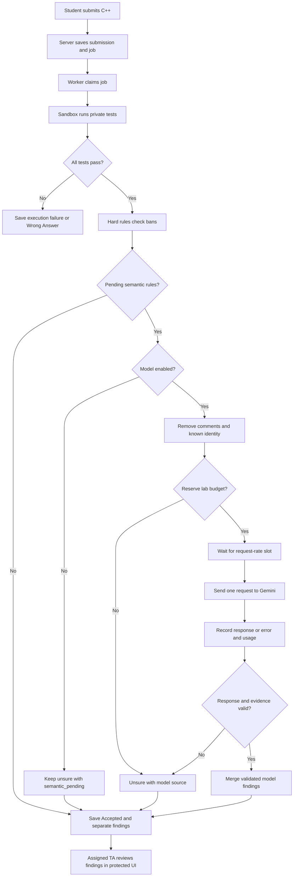
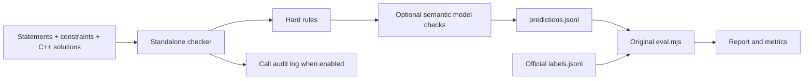

# Model checker: simple walkthrough

## 1. Where does Member 2 fit?

- Normal tests ask: **Does the program print the correct answer?**
- Hard rules ask: **Does the code use a banned statement, type, or function?**
- The model asks: **Does the code follow the remaining assignment requirements?**
- Model findings are saved for TA review. They never choose a deduction.



- Comment-cleaning failures and timeouts also become `unsure`.
- The TA review API/UI is implemented separately from this checker. It stores decisions/history and shows local unsure reasons; it does not yet publish marks. See [review flow](REVIEW-PUBLISH-FLOW.md).
- See [worker flow](WORKER-FLOW.md) for job ownership and normal judging.

## 2. Follow a real submission

**Lab:** Order two integers.

| Input | Expected output |
|---|---|
| `3 1` | `1 3` |
| `-2 5` | `-2 5` |
| `4 4` | `4 4` |

The actual smoke submission was:

```cpp
// Member 2 real worker smoke; manual-student@example.test
#include <iostream>
int main() {
    const char* identity = "manual-student@example.test";
    (void)identity;
    int a, b;
    std::cin >> a >> b;
    if (a > b) { int temp = a; a = b; b = temp; }
    std::cout << a << " " << b << "\n";
}
```

| Requirement | Who checks it? | Actual result |
|---|---|---|
| Do not call `std::sort` | Hard rules | `pass` |
| Use a comparison to order the numbers | Gemini | `pass`, evidence at line 8 |

- The sandbox tests passed, so the judge result was **Accepted**.
- The comment was blanked before provider access.
- The known email inside the literal was replaced with spaces.
- Line numbers stayed unchanged. Line 8 still pointed to the comparison.
- [Saved database evidence](../../eval/runs/real-worker/result.json)
  records this actual run.

## 3. Files involved

| File | Simple job |
|---|---|
| [worker.go](../../backend/internal/worker/worker.go) | Runs tests and then requests constraint checking |
| [semantic/check.go](../../backend/internal/semantic/check.go) | Selects semantic rules and validates answers |
| [semantic/source.go](../../backend/internal/semantic/source.go) | Removes comments while keeping source lines |
| [worker/model.go](../../backend/internal/worker/model.go) | Reserves lab budget and saves call logs |
| [semantic/rate.go](../../backend/internal/semantic/rate.go) | Spaces requests at least five seconds apart per process |
| [semantic/gemini.go](../../backend/internal/semantic/gemini.go) | Calls Google and reads usage information |
| [checker/dataset.go](../../backend/internal/checker/dataset.go) | Uses the same checking flow on dataset files |

## 4. Step by step, with code

### Step 1: the worker reaches the model after hard rules

**File:** `internal/worker/worker.go`, function `judge()`.

```go
checks, err := hardrules.Check(ctx, w.Runner, source, constraints)
```

Later in the same function:

```go
checker := w.SemanticFor(lab, job.SubmissionID)
checker.Redactions = []string{studentID, email}
```

```go
checks = checker.Check(ctx, statement, source, constraints, checks)
```

- The worker supplies original code, rule descriptions, and existing findings.
- Known account identifiers are supplied locally for removal, not as model metadata.
- The email local part is also included when it is at least three characters long.

### Step 2: select only pending semantic rules

**File:** `internal/semantic/check.go`, function `Check()`.

```go
if check.Source != "semantic_pending" {
    continue
}
```

```go
if len(pending) == 0 {
    return out
}
```

| Finding before this step | What happens? |
|---|---|
| Sort ban: `pass` / `hard_rule` | Preserved; not sent to Gemini |
| Comparison rule: `unsure` / `semantic_pending` | Selected for semantic checking |
| Any hard-rule analysis failure | Preserved as unsure; not sent to Gemini |

The checker initializes pending findings and their local reasons before returning when disabled or unconfigured. With a configured enabled model, their source becomes `model`; otherwise they retain `semantic_pending`.

### Step 3: clean the input and set a deadline

**File:** `internal/semantic/check.go`, function `Check()`.

```go
callCtx, cancel := context.WithTimeout(ctx, timeout)
defer cancel()

cleaned, err := stripComments(string(source))
```

```go
cleaned = redact(cleaned, c.Redactions)
statement = redact(statement, c.Redactions)
```

- Default deadline: **20 seconds**, including budget and rate waiting.
- Comments become spaces; quoted C++ literals are preserved unless redacted.
- Known identities are removed from code, statement, and constraint text.
- No account metadata, deductions, private tests, or expected answers are sent.
- Unknown personal names cannot reliably be inferred from the current account schema.

### Step 4: reserve money before contacting Google

**File:** `internal/worker/model.go`, function `Generate()`.

```go
if err := reserveCall(ctx, m.db, callID, m.lab, m.submission, m.config.BudgetMicroUSD); err != nil {
    return nil, err
}

return model.Generate(ctx, request)
```

| Budget action | Meaning |
|---|---|
| Lock the lab row | Two workers cannot spend the same remaining budget |
| Add `model_calls` reservation | Keep the cost limit across worker restarts |
| Reserve 478,413 microdollars | Conservative maximum estimate: US$0.478413 |
| Insufficient budget | Return unsure without a provider request |
| Known usage after request | Replace reservation with the actual token-based estimate |
| Unknown usage or worker crash | Keep the full reservation |

- Default application cap: **US$1 per lab**, cumulative across submissions.
- A reservation is a local budget charge, not a provider invoice.

### Step 5: wait, then make one provider request

**File:** `internal/semantic/rate.go`.

```go
var providerRate = rateLimiter{interval: 5 * time.Second}
```

**File:** `internal/semantic/gemini.go`, function `Generate()`.

```go
if err := g.wait(ctx); err != nil {
    entry.Outcome = "cancelled_before_request"
    return nil, err
}
```

```go
res, err := g.client.Do(req)
```

- Authentication uses the worker's key in an HTTP header.
- The sandbox receives no model key or worker environment.
- There are no automatic retries.
- Separate worker processes or other apps using the key need coordinated limits.

Before sending, `semantic/gemini.go` turns cleaned source into numbered objects:

```json
{"code":[{"line":1,"text":"#include <iostream>"},{"line":2,"text":"int main() {}"}]}
```

This is an excerpt of the wire payload; it also carries the statement and pending constraints. Numbering makes the line number explicit instead of asking the model to count. The regression test `TestGeminiSendsNumberedLines` preceded the fix (test `c05230c`, fix `1cdc486`, PR #22). Evidence validation remains exact; it never accepts matching text from a different line.

### Step 6: log usage and validate the answer

**File:** `internal/semantic/check.go`, function `Check()`.

```go
raw, err := c.Model.Generate(callCtx, Request{
    Statement: statement, Constraints: pending, Source: cleaned,
})
```

```go
validated, err := validate(raw, pending, cleaned, string(source))
if err != nil {
    // Actual code assigns a locally determined schema/evidence reason.
    return out
}
```

The provider adapter records the call before local verdict validation finishes.

| Check | On failure |
|---|---|
| All expected constraint IDs appear once | Whole semantic batch becomes unsure |
| Verdict is pass, violation, or unsure | Whole semantic batch becomes unsure |
| No extra fields or duplicate JSON keys | Whole semantic batch becomes unsure |
| Pass/violation has evidence | Whole semantic batch becomes unsure |
| Evidence line/text matches cleaned source | Whole semantic batch becomes unsure |
| Provider fails or deadline expires | Pending semantic findings stay unsure |

Exact original source text is restored for stored evidence:

```go
evidence = append(evidence, hardrules.Evidence{
    Line: point.Line, Text: originalLines[point.Line-1],
})
```

- Correct line text is necessary; it does not guarantee strong reasoning.
- A real line can still be poor proof of a claimed violation.

### Step 7: merge and save results

**File:** `internal/semantic/check.go`.

```go
for _, verdict := range validated {
    out[positions[verdict.ConstraintID]] = verdict
}
```

**File:** `internal/worker/worker.go`.

```go
return w.Complete(ctx, job, "Accepted", "All test cases passed.", checks)
```

| Table | Actual smoke result |
|---|---|
| `judge_results` | Accepted |
| `constraint_verdicts` | Hard-rule pass and model pass, with separate sources |
| `model_calls` | Recorded provider ID, prompt, response, tokens, duration, and cost |
| `jobs` | Completed, guarded by the current worker's lease token |

- The model finding does not change Accepted into Wrong Answer.
- Student status endpoints exclude these protected findings and deductions.
- The implemented TA review workflow records a separate decision, TA identity/history and configured deduction. Unsure reasons distinguish schema/evidence failures, timeout/cancellation, provider failure, exhausted budget, disabled/unconfigured checking and source preparation failure. These reasons are determined locally, not accepted from the model. Publishing remains PA4 work.

## 5. The second flow: evaluating the checker



- The checker never reads labels. Only the separate evaluator reads them.
- The dataset already contains Accepted programs; the checker analyzes them.
- With `MODEL_OFF=1`, semantic rules stay unsure and no model request occurs.
- In the offline image, source analysis runs inside the restricted checker container;
  it needs no Docker socket and does not execute the submitted program.
- The dataset command uses a per-problem budget for each run. The application
  worker uses persistent per-lab database reservations.

| Real dev-set result | Value |
|---|---:|
| Wrongful deductions | 0 |
| Recall | 94.6%: 35 of 37 violations caught with accepted evidence |
| Unsure | 2.0%: 2 of 102 pairs |
| Successful calls with provider request IDs | 39 of 39 |
| Estimated cost | US$0.020851 for this official-only run |
| Original evaluator exit | 0: PASS |

- Source: [November 24 numbered-line run](../../eval/runs/real-dev-numbered/report.txt), [metrics](../../eval/runs/real-dev-numbered/summary.json), [usage](../../eval/runs/real-dev-numbered/usage-summary.json), checker code `1cdc486`.
- Keep the [November 22 run](../../eval/runs/real-dev/report.txt) unchanged: 0 wrongful, 56.8% recall, 30.4% unsure, exit 1. Provider 503 errors without request IDs/usage, retained budget reservations and evidence rejection are historical limitations; do not describe them as successful identified calls.
- These are saved results, not promises about future model answers. The later run meets all three dev thresholds; PA4 still requires fresh real-model CI, ten own cases, three runs of one commit and the lecturer's held-out run. See [PA4 plan](../PA4/PA4-PLAN.md).

## 6. Read next

- [Member 2 handoff](../PA3/MEMBER2-HANDOFF.md): evidence, costs, interfaces, and limits.
- [Evaluation commands](../../eval/README.md): native and Docker commands.
- [Backend connections](BACKEND-CONNECTIONS.md): server, queue, sandbox, and hard rules.
