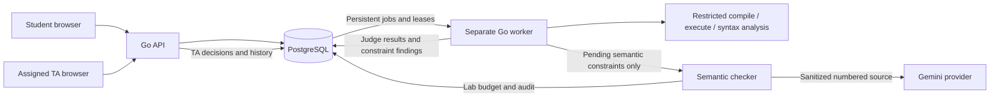

# Architecture and mechanisms

This folder is the central reference for the implemented system and how its parts work. Reviewed November 25, 2026 against the final PA3 source. Update these guides when behavior or schema changes; keep milestone plans, dated acceptance records, deployment evidence and rubric reports in their existing locations.

| Guide | Read it for |
| --- | --- |
| [Backend](BACKEND.md) | Programs, packages, API routes, configuration and checks |
| [Database](DATABASE.md) | Current schema through migration 00007, relationships, storage and visibility |
| [Backend connections](BACKEND-CONNECTIONS.md) | Browser/API/database/worker/sandbox/model/TA interactions |
| [Worker flow](WORKER-FLOW.md) | Queue claims, leases, judging, semantic checking and transactional result saving |
| [Hard-rule flow](HARD-RULE-FLOW.md) | Syntax-aware bans, original-source evidence and semantic routing |
| [Model checker flow](MODEL-CHECKER-FLOW.md) | Sanitized numbered input, budgets, validation, unsure reasons and saved evaluation |
| [Sandbox attacks](SANDBOX-ATTACKS.md) | Container protections and the nine attack fixtures |
| [Review and Publish flow](REVIEW-PUBLISH-FLOW.md) | Implemented TA decisions/history and explicitly planned PA4 sampling/publication |

## Current system

The worker controls Docker on the trusted host; student-code containers receive no network, host mounts, Docker socket or secrets. Student status reads expose judging results, while findings/reasons and TA deductions stay in class-protected review views. TA decisions do not yet publish marks. PA4 adds persisted random pass sampling and API-enforced Publish; neither appears as an implemented component above.

## Related documentation

- [Project progress](../PROJECT-PROGRESS.md) and [PA4 plan](../PA4/PA4-PLAN.md) track completion and ownership.
- [PA3 report](../../PA3.md), [TA review evidence](../PA3/TA-REVIEW-QUEUE.md), and [handoff acceptance](../PA3/MEMBER3-ACCEPTANCE.md) record delivered evidence.
- [Submission contract](../contract/submissions.md), [browsing contract](../contract/frontend-browsing.md), and [frontend design plan](../FRONTEND-DESIGN-PLAN.md) describe their respective interfaces/design scope.
- [Public deployment runbook](../PA3/PUBLIC-DEPLOYMENT.md) and [evaluation guide](../../eval/README.md) contain operating commands.

These guides were consolidated from `docs/BACKEND.md`, `docs/DATABASE.md` and `docs/PA3/backend-mechanism/`. Maintain one current copy here rather than copying mechanisms into each milestone folder. Historical log entries retain their original context.
