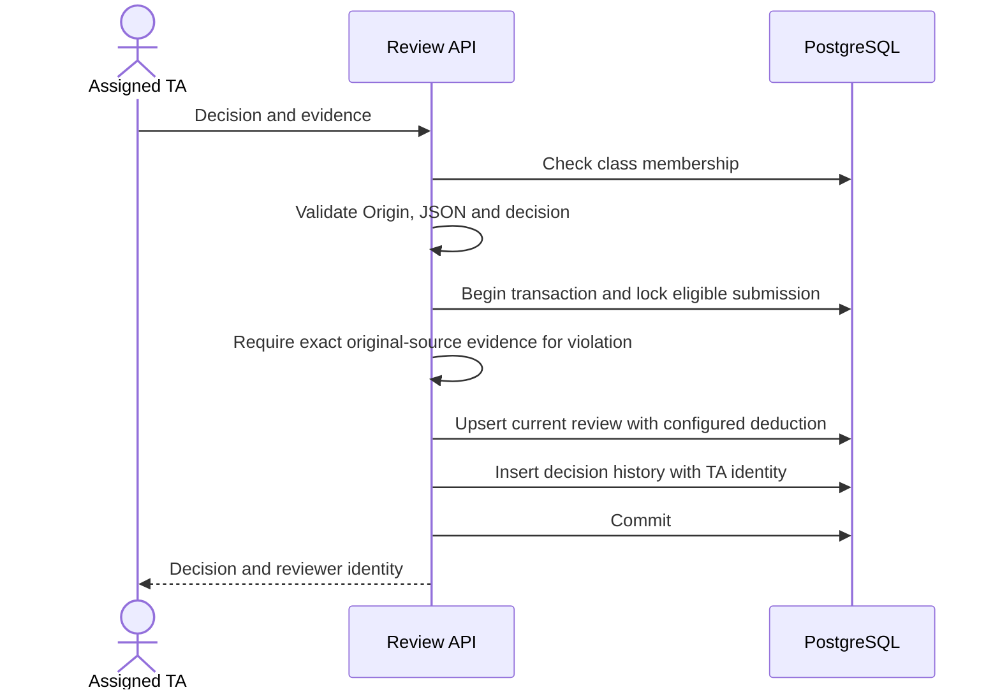
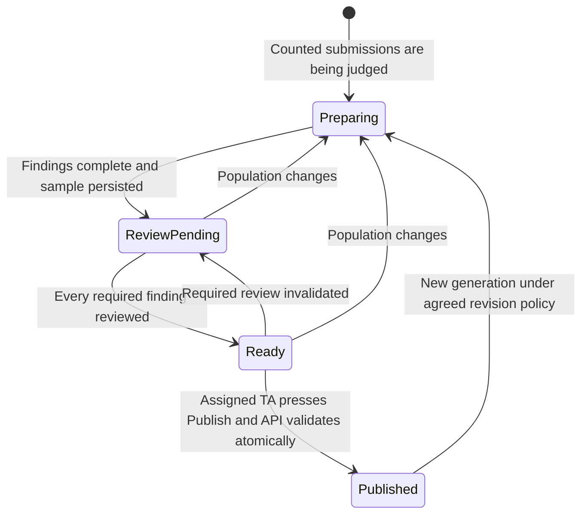

# TA review and Publish flow

**Reviewed:** November 25, 2026. The first sections describe implemented PA3 behavior. The PA4 design below is proposed work: there is currently no pass-sampling persistence, Publish endpoint, publication table or student marks endpoint.

## Implemented review path

| Component | Source |
| --- | --- |
| Class authorization, queue, earlier submissions and decisions | [review.go](../../backend/internal/api/review.go) |
| Registered routes | [server.go](../../backend/internal/api/server.go) |
| Current decision and history schema | [00006_reviews.sql](../../backend/migrations/00006_reviews.sql) |
| Finding reason schema | [00007_verdict_reasons.sql](../../backend/migrations/00007_verdict_reasons.sql) |
| TA review screen | [review.tsx](../../frontend/src/pages/review.tsx) |
| Existing verification and FAQ references | [TA review evidence](../PA3/TA-REVIEW-QUEUE.md) |

Direct Go routes below omit the browser's `/api` prefix:

| Route | Behavior |
| --- | --- |
| `GET /labs/{labId}/review-queue` | Assigned TA sees every constraint finding for each student's latest counted Accepted submission, with source, verdict, reason, exact evidence, configured deduction and any TA decision |
| `GET /labs/{labId}/earlier-submissions` | Assigned TA can inspect replaced submissions and their findings read-only |
| `POST /labs/{labId}/submissions/{submissionId}/constraints/{constraintId}/review` | Assigned TA records pass or violation for the latest counted Accepted submission, with valid Origin and strict request fields |

The membership check joins the lab's class with `class_tas`. Non-TA roles receive 403; an unknown lab or a TA from another class receives 404. An admin role does not bypass the TA-only review check.

Latest is selected by `(created_at, id)` within each student/lab. A newer pending or failed submission still replaces the older attempt for counting; the queue only includes it after it is judged Accepted and has findings. Earlier attempts stay readable through the separate endpoint, and the decision route refuses them.

The queue currently includes all pass findings as well as violations/unsure. It is not PA4's required random 10% pass sample.

## Saving a TA decision

A pass requires empty evidence and stores deduction 0. A violation requires nonempty evidence whose line numbers and text match the submitted source exactly; the deduction comes from `lab_constraints.deduction`. The caller cannot submit a deduction field. Current review and history are saved in one transaction.

`constraint_verdicts` remains the worker's finding. `constraint_reviews` is the TA's current decision; `constraint_review_history` records each API review action and reviewer. The API appends history, but the database schema does not enforce immutability by itself. The queue returns the current decision, not a full history feed.

These writes do not publish a mark. Student submission endpoints do not read review findings, reasons, evidence or deductions. Unsure causes are set locally by checker/worker code and displayed to the assigned TA, including exhausted budget and timeout; they are not free-form model explanations.

## Planned PA4 review population and sampling

**Status: design to implement and test.** [Member 1's PA4 checklist](../PA4/PA4-PLAN.md#member-1--server-sampling-required-reviews-and-publish) owns the backend; Member 3 integrates the UI. Route names, response shapes and migration details must be agreed in a contract before implementation.

1. Define a review generation for the lab's current counted submissions, findings and constraint configuration. Incomplete judging/checking must not silently make a missing result eligible for publication.
2. Require review of every violation and every unsure finding in that generation.
3. From the pass findings, draw `ceil(0.10 × pass count)` randomly on the server, with no duplicates. Zero passes yields zero sampled findings. Persist both the selection and its generation; reading the queue or restarting a service must not redraw it.
4. Preserve optional TA access to other findings and earlier submissions while distinguishing which findings block Publish.
5. Treat new counted submissions, changed constraints or rejudging as changes to the review population. A stale review/sample cannot authorize a different generation. Define the refresh and publication policy in the contract and test it.

Proposed additional records must represent the generation, persisted sample, publication snapshot and publishing TA/time. These are design requirements, not existing tables or settled column names. Reuse the current finding/review distinction and history rather than putting a mark on a model finding.

## Planned Publish state transitions

**Status: proposed behavior, not a current endpoint.**

The states describe the planned logical workflow, not database enums. The contract must specify how an existing published snapshot behaves when a new generation is prepared; implementation must not expose partial revisions or silently replace published results.

Publish must check the authenticated role and database class membership, then verify the same generation and every required review inside a transaction coordinated with population changes. A disabled button is only a UI aid. Pending violations, unsure findings or sampled passes must make a direct Publish request fail; a student and another class's TA must also be refused.

Only a successful Publish makes the reviewed deduction visible to its owning student. Preserve the separation between model findings, TA decisions and published results. The worker/checker has no mark-writing path. Retrying Publish must not create duplicate or conflicting results; decide idempotency and revision behavior in the contract.

## Acceptance evidence still required for PA4

- A fixed-seed test exercises the production sampling path, including size, unique membership, non-first-row selection, edge counts and persistence across reads/restarts.
- Direct API tests deny Publish with each required-review type pending, deny student/other-class TA callers and permit the assigned TA after all required reviews.
- Tests show that newer submissions or changed findings/constraints invalidate stale authorization, including a concurrent update at publication time.
- Integration/browser evidence shows no student deduction before Publish and the correct TA-configured deduction afterward, including malicious model deduction fields/instructions.
- The deployed injection tests remain violation or unsure, never pass, for violating solutions.
- Root `PA4.md` explains **Where we stop it** using the team's own evaluation/deduction numbers: who pays, how mistakes are detected, why the gate is at Publish, and the cost of unsampled passes that hide missed violations.

See the [PA4 plan](../PA4/PA4-PLAN.md) for owners, dated handoffs and remaining release evidence. Full appeals behavior belongs to PA5.
